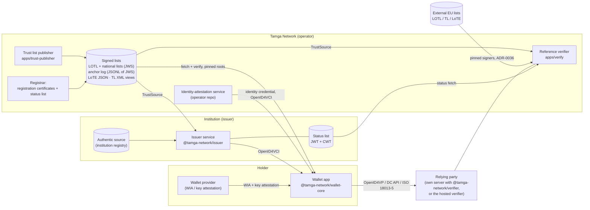
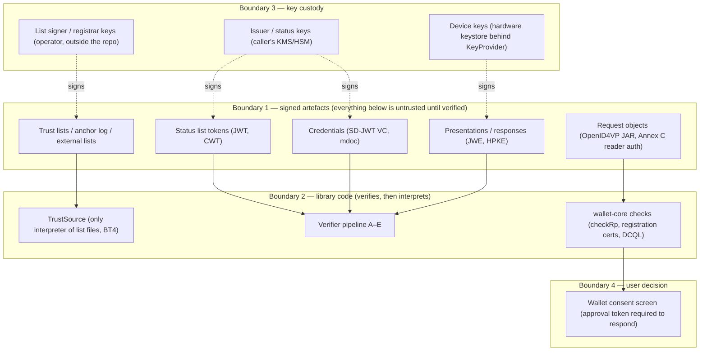

# Architecture, trust model and threat model

## 1. What the system is

Tamga Network is a trust network for digital credentials built on the EU digital identity profiles (eIDAS 2.0 / EUDI ARF):
SD-JWT VC and ISO mdoc credentials, OpenID4VCI 1.0 for issuance, OpenID4VP 1.0 (HAIP profile) and ISO 18013-5/-7 for
presentation, X.509 for institutional identity and **signed trust lists** as the root of trust. The network itself operates no
wallet (ADR-0042); it publishes the lists that wallets, issuers and verifiers rely on, plus open-source libraries and a reference
verifier.

A permissioned blockchain (Besu QBFT) is designed as a later *projection* of the signed lists (ADR-0009 K4, ADR-0051); it is
**not running**. Today all trust data comes from signed lists and an append-only anchor log.

### Components in scope

| Component | Role | Holds keys? |
|---|---|---|
| `apps/trust-publisher` | Builds LOTL and national lists from registry source files, signs them (ES256, `typ: tamga-tl+jwt`), appends the anchor log, produces ETSI LoTE / TL XML views and registration certificates (+ their 1-bit status list) | list signer, registrar key (outside the repo; development keys are generated locally under `ops/pki/`, gitignored) |
| `packages/trust` | Loads and verifies lists; `TrustSource` answers every trust question (BT4) | no |
| `packages/issuer` | Issuer-side protocol logic; the operator's issuer service and institutions' own services use it | issuer credential key and separate status key (S11) — held by the caller (KMS/HSM interface) |
| `packages/verifier` + `apps/verify` | Request creation, response decryption, verification pipeline A–E, status cache | request-object signing key (access certificate), ephemeral response-encryption keys |
| `packages/wallet-core` | Wallet logic; device keys are behind a `KeyProvider` interface (hardware keystore in the app) | no keys itself |
| `packages/sd-jwt`, `packages/mdoc`, `packages/core` | Formats and codecs | no |
| `packages/zk` | ZK prover (wallet side) | no |

## 2. Trust model

**Roots.** Every party pins the fingerprint(s) of the LOTL signer (root) out of band (wallet: compiled-in pins; verifier and
issuer: configuration). The LOTL names national lists and their signing keys; national lists name issuers (with certificate
fingerprints and delegate keys such as the status-list key), relying parties (with registered scopes), wallet providers, root
CAs, schemas and external lists. `issuer_id = keccak256(state, sha256(cert))`, `schema_id = keccak256(vct)` — the same
identifiers the chain stage uses.

**Freshness and rollback.** Lists carry `version`, `next_update` and `previous_version_hash`; loaders remember the last version
seen (TL2; persistent memory can be injected) and reject a lower version. The public anchor log (hash-chained JWS lines) makes a
rewritten history visible but, with one operator, does not prevent it — accepted risk until a second independent operator
exists.

**External (EU) lists.** Loaded only if the LOTL lists them with pinned signer fingerprints (ADR-0036 FD1); each is independent —
a failing external list makes questions about it UNKNOWN, it never degrades Tamga's own lists.

**Credentials.** Issuer signature chains to a certificate whose fingerprint is in the list for that issuer and schema
(C1/C2 evaluated at the credential's `iat`); holder binding via `cnf.jwk` (SD-JWT) / `deviceKey` (mdoc); status via IETF
Token Status List signed by the issuer's registered status key (pinned, ADR-0056 K6).

**Relying parties.** Requests are signed (`x509_hash` client identifier, HAIP); the wallet accepts a request only if the signing
certificate maps to a registered relying party whose registration certificate covers every requested claim (ADR-0026);
over-asking makes the request invalid. Response addresses must belong to the certificate's DNS names.

**Result semantics.** Verification returns ACCEPTED / REJECTED / INDETERMINATE; infrastructure failure is INDETERMINATE, never
REJECTED and never ACCEPTED (AP2, CMP9).

## 3. Threat model

### 3.1 Assets

| Asset | Why it matters |
|---|---|
| Integrity of trust lists and anchor log | Decides who is an issuer / verifier / wallet provider |
| Issuer signing keys and status keys | Forging or silently un-revoking credentials |
| Correctness of the verification result | Business decisions (admission, age, employment) rest on ACCEPTED |
| Holder personal data | Disclosed claims, identity attributes; must reach only the registered RP, only what was approved |
| Unlinkability | Pseudonyms per site (ADR-0031), no credential hash in any public artefact (DP1) |
| Availability of status and list endpoints | Without them verifiers return INDETERMINATE |

### 3.2 Actors

| Actor | Capability assumed |
|---|---|
| Network attacker | Full control of the network between parties (TLS assumed where used, but signed artefacts must not rely on TLS) |
| Malicious relying party | Holds a valid, registered access certificate; tries to over-ask, replay, redirect, link users, or forge a decline |
| Unregistered / spoofed verifier | Self-signed certificates, look-alike origins, malicious web page using the DC API |
| Malicious or compromised issuer | Registered issuer that signs hostile content (malformed payloads, huge status lists, prototype tricks) |
| Malicious wallet / holder | Replays presentations, presents stolen credentials without the device key, crafts responses |
| Bystander | Sees the QR code / `request_uri` of someone else's presentation |
| Compromised list operator key | Out of scope for prevention today (single operator); detection via anchor log |
| Malicious external list | A pinned external signer publishing hostile content |

### 3.3 Trust boundaries

### 3.4 Main threats and where they are addressed

| # | Threat | Mitigation (code / decision) | Residual |
|---|---|---|---|
| T1 | Forged or rolled-back trust list | ES256 JWS with pinned roots; version memory (TL2); anchor log | single operator can equivocate undetected by a client that only fetches once (accepted, S-6) |
| T2 | Verifier accepts credential from unlisted issuer / wrong schema | C1/C2 via `TrustSource` at `iat`; three-valued result | — |
| T3 | Revoked credential accepted | status token signer pinned (ADR-0056 K6), `exp`/`maxAgeSec`, out-of-range index fails closed (D6), unknown values not VALID | revocation latency (minutes; token valid ≤ 6 h); ZK presentations cannot check status (ADR-0044 short-lived copies) |
| T4 | Replay / relay of a presentation | `nonce`, `aud`, `sd_hash`, KB-JWT `iat` window, encrypted responses bound to the request branch key; mdoc SessionTranscript | — |
| T5 | Relying party over-asks or redirects data | signed request, registration certificate scope check, response URI ∈ certificate SAN, consent with approval token | collusion of verifiers can link presentations of the same credential (accepted, documented) |
| T6 | Bystander forges a decline (OpenID4VP error responses are unauthenticated) | per-fetch request branches, soft decline (ADR-0067) | — |
| T7 | Malicious web page uses the DC API | `expected_origins` signed in the request; Annex C reader signature over the session transcript incl. origin | device-level Android activity export to be verified on device |
| T8 | Parser DoS / memory exhaustion | strict CBOR (depth, lengths, duplicates, trailing bytes), bounded zlib inflate, size limits, XML without DTD, structure depth limits | property/fuzz tests in `build-and-test.md` |
| T9 | Signature wrapping in XML lists | single `ds:Signature` under root, whole-document reference with enveloped transform required, data read only from the verified DOM, signer pinned before expensive work | own XMLDSig implementation — review requested |
| T10 | Personal data leakage into public artefacts or logs | invariants DP1, AP3/AP4, PR14; ABI-level privacy test for contracts; audit records hold event names and policy IDs only | — |
| T11 | Wallet without hardware keys | provider issues WIA only to hardware-attested units (WL1/WL3) | iOS attestation pending (S-14) |
| T12 | Token theft at the issuer | DPoP-bound access and refresh tokens; PAR; refresh bound to client instance key (ADR-0060) | — |
| T13 | Misuse of library APIs by integrators | misuse-resistant defaults (ADR-0056): security inputs mandatory, opting out is an explicit `"none"` | — |
