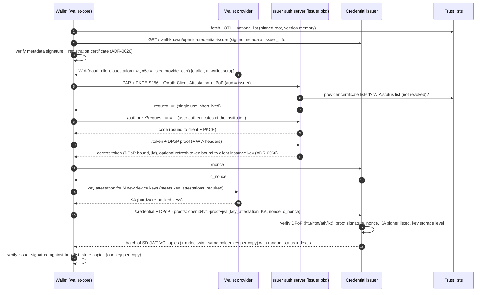
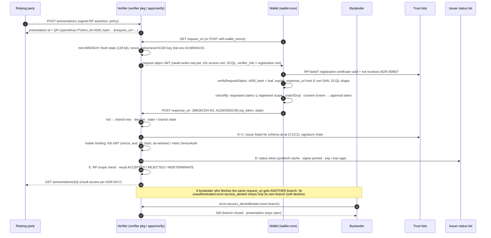
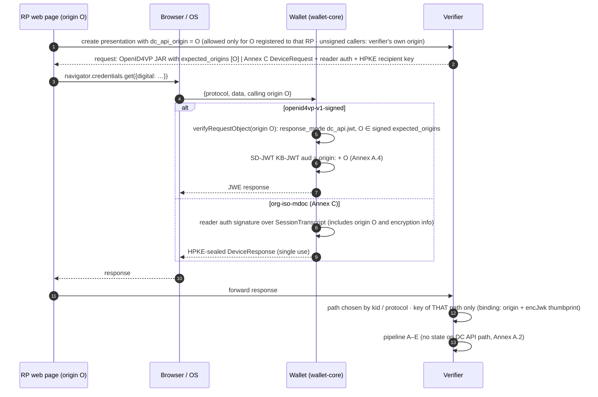
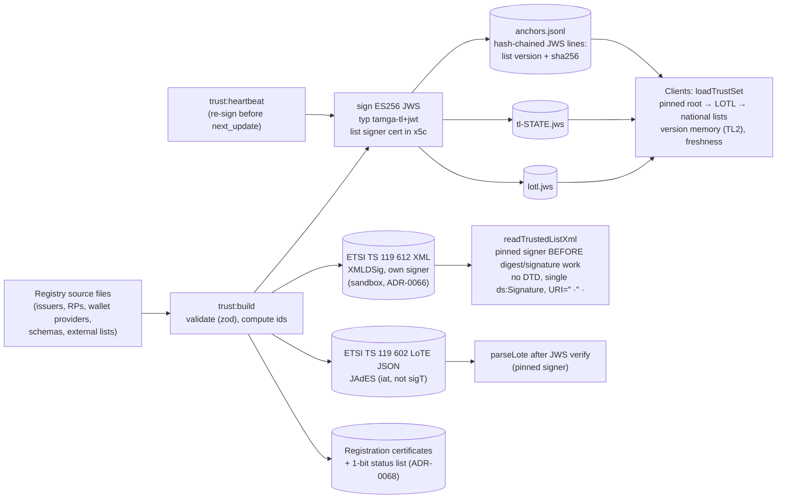
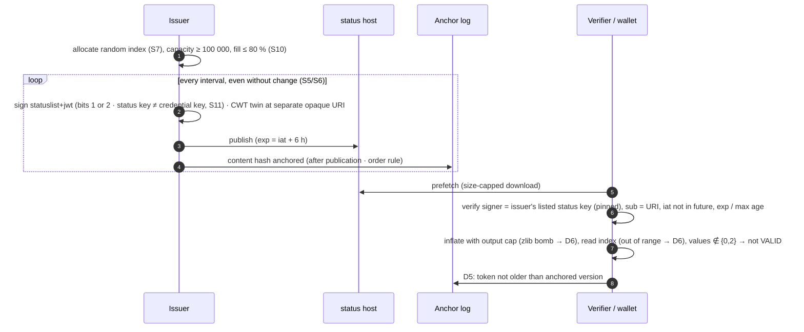
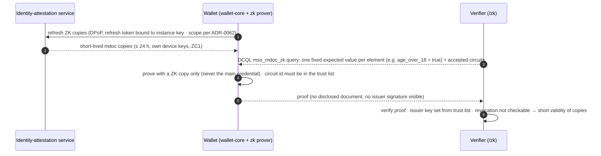
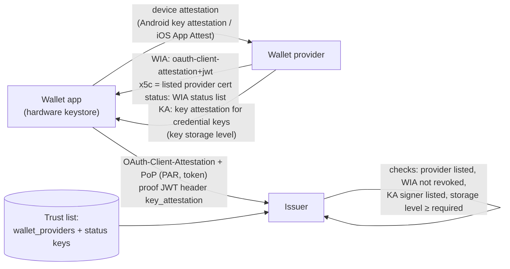

# Data flows

Diagrams are Mermaid (rendered on GitHub). Step codes in brackets (A1…E4, C1…, S1…) are the project's verification-pipeline
steps and invariant codes; see `invariants.md`. Every arrow that carries a signed artefact is verified by the receiver before use.

## 1. Issuance — OpenID4VCI 1.0 (authorisation code, PAR, DPoP, wallet attestations)

Wallet instance attestation (WIA) authenticates the wallet as the OAuth client (attestation-based client authentication);
key attestation (KA) proves that the credential keys live in hardware. Both are issued by the wallet provider, whose
certificate must be listed in the trust list (`wallet_providers`).

Pre-authorised flow (on-screen / out-of-band / identity-bound offers) replaces steps 5–10 with `pre-authorized_code`; the
`tx_code` is delivered over a different channel than the offer (S5 rule); attempts are limited.

## 2. Presentation — OpenID4VP 1.0, cross-device (`direct_post.jwt`), with per-fetch branches (ADR-0067)

## 3. Presentation in the browser — W3C Digital Credentials API

Two protocols: signed OpenID4VP (`openid4vp-v1-signed`, OpenID4VP Annex A) and ISO/IEC 18013-7 Annex C (`org-iso-mdoc`,
HPKE). Unsigned requests are refused by the wallet (PV6).

## 4. Trust list publication (JSON + XML)

## 5. Status lists (IETF Token Status List; ADR-0008, ADR-0048, ADR-0063)

## 6. ZK copies (ADR-0032, ADR-0044)

## 7. Wallet provider: wallet instance attestation and key attestation (ADR-0025, ADR-0034, ADR-0047)

The network lists wallet providers; it does not operate one (ADR-0042). The provider protocol is the wallet's own; the parts
in scope here are what issuers and wallets verify.

